<!-- ============ HEADER ============ -->

  <h1>Hello there 👋</h1>
  
I'm an indie game designer and developer

  

    I make games people remember: ones that make you feel something and enjoy
    the journey
  

<!-- ============ FEATURED WORK ============ -->

  <h2>Featured Work</h2>
  

    🌱 <b><a href="https://snogg.itch.io/the-heart-of-the-garden">The Heart of the Garden</a></b
    >: a short first-person game about love and attention 
    🧰 <b><a href="https://assetstore.unity.com/publishers/116963">Snog on the Unity Asset Store</a></b
    >: Dialogue and Interaction System 
    🔪
    <b
      ><a href="https://github.com/Jobberson/ShadowsOfDoubtExpanded"
        >Shadows of Doubt Expanded</a
      ></b
    >: custom serial killer archetypes mod
  

  

    <a href="https://pedroschenegoski.com">Portfolio</a> ·
    <a href="mailto:pedro@pedroschenegoski.com">Contact</a>
  

<!-- ============ SKILLS ============ -->

  <h2>Things I Know</h2>

  

    <h3>Engines</h3>
    
  

  

    <h3>Languages</h3>
    
  

  

    <h3>Tools</h3>
    

      
    

    

      
      
      
    

  

<!-- ============ STATS ============ -->

  <h2>My Stats</h2>
  

    
  

  

    
  

<!-- ============ FOOTER ============ -->

  

